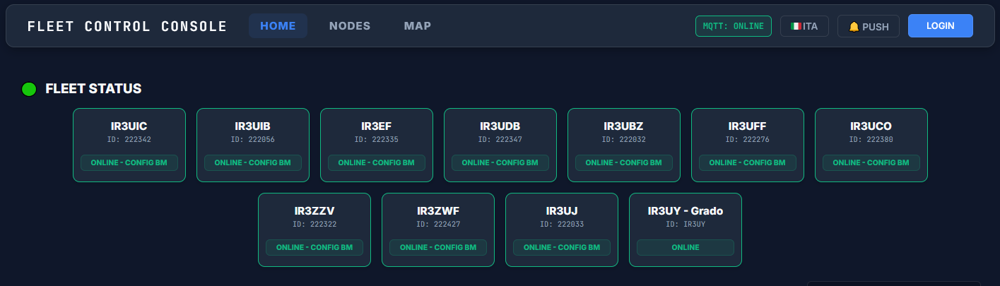

# 📡 Fleet Control Console - Server (Central Hub) v6.0.0

🌍 *[Read in English](#english) | 🇮🇹 [Leggi in Italiano](#italiano)*

---



<a name="english"></a>
## 🇬🇧 English

**Fleet Control Console** is a professional, real-time command and control (C2) dashboard designed for amateur radio repeater networks (MMDVM). This repository contains the **Server (Central Hub)** component, which provides a centralized web interface to monitor and manage a fleet of remote digital voice nodes (DMR, NXDN, YSF, P25).

> ℹ️ **Note:** This is the Central Server repository. To monitor remote repeaters, you must install the [Fleet Control Agent](https://git.arifvg.it/iv3jdv/fleet-node-agent.git) on each node.

### 🏗️ Architecture & Technology Stack
The server acts as the brain of the network, built on a highly scalable foundation (v6.0.0):
* **Modular Backend:** Completely decoupled architecture (`core/`, `services/`, `routes/`) for high maintainability and robust background task handling.
* **Core Engine:** Flask (Python) with `gevent` for high-concurrency WebSocket handling.
* **Database:** SQLite (WAL mode) for robust User Management, Audit Logs, Schedules, and Radio Traffic storage.
* **Communication:** MQTT for instant data routing + WebSockets (SocketIO) for zero-latency UI updates.
* **Frontend:** Vanilla JS with a modern *Glassmorphism Borderless Executive* NOC (Network Operations Center) design. Full i18n (Internationalization) support for English and Italian.

### ✨ Ultimate Features (v6.0.0)

#### 🗓️ Calendar Profile Scheduler [NEW]
* Plan automated profile switches (e.g., Regional Nets, Contests, Civil Defense drills) across multiple nodes.
* Seamless background execution: the system automatically triggers the `Target Profile` at the specified start time and gracefully falls back to the `Restore Profile` once the event ends.

#### 🗺️ Tactical APRS Map [NEW]
* Real-time GIS map showing both your fixed repeater locations and **roaming APRS stations**.
* Automatically extracts and parses APRS payloads from gateway logs.
* Features a smart Garbage Collector that automatically cleans up roaming pins after 2 hours of inactivity.

#### 🛠️ Advanced Remote Control & Visual Diff [NEW]
* **Time Machine Config Editor:** Edit daemon configuration files (e.g., MMDVMHost.ini) directly from the web interface, with the ability to rollback to previous historical backups.
* **Semantic Visual Diff:** Compare your local unsaved edits against the running config with a rich Green/Red semantic diff viewer before safely committing changes to the node.
* **OTA Server Updates:** Apply server-side Git updates directly from the admin dashboard without SSH access.
* **Service Management & Hardware:** Start/Stop/Restart remote daemons, trigger physical OS reboots, or hard GPIO resets of the MMDVM HAT.

#### 📈 Dynamic Analytics & Monitoring [NEW]
* **Timeframe Analytics:** Interactive historical charts (Chart.js) for CPU/Temp and RF Transits/BER. Zoom dynamically across 12H, 24H, 48H, or 7D timeframes with smart axis labeling.
* **Live WebSocket Console:** Zero-latency terminal streams for node daemons. Real-time active operator tracking (see who is logged in and managing the dashboard).
* **Proactive Diagnostics (Watchdog):** Continuous analysis of remote CPU temperatures, disk space, and RF BER. Triggers automated Web Push Notifications.

#### 🔐 Strict Security & Access Control
* **Role-Based Access Control (RBAC):** True Zero-Trust architecture. Node management is bound to explicitly assigned nodes (`allowed_nodes`) for both *Operators* and *Node Admins*.
* **System Administration:** Admins retain exclusive rights to global server settings, schedules, and user management.
* **Security Audit Trail:** Every critical action (reboots, config edits, schedules) is securely logged with username, timestamp, and target node.

### ⚠️ Security Requirement: HTTPS
**Web Push Notifications** and the **Service Worker** require a secure connection. Modern browsers only enable these features over **HTTPS**. We recommend using a reverse proxy (like Nginx, Caddy, or Apache) with an SSL certificate.

### ⚠️ Reverse Proxy & WebSocket Configuration
If using a reverse proxy like **Apache** on HTTPS, you must enable WebSocket tunneling:
```bash
sudo a2enmod proxy_wstunnel rewrite headers
```
Insert the **Rewrite** rules *before* the `ProxyPass` directives in your `<VirtualHost *:443>`:
```apache
RewriteEngine On
RewriteCond %{HTTP:Upgrade} =websocket [NC]
RewriteRule /(.*)           ws://127.0.0.1:9000/$1 [P,L]
RewriteCond %{HTTP:Upgrade} !=websocket [NC]
RewriteRule /(.*)           http://127.0.0.1:9000/$1 [P,L]

ProxyPass /socket.io/ ws://127.0.0.1:9000/socket.io/
ProxyPassReverse /socket.io/ ws://127.0.0.1:9000/socket.io/

ProxyPass / http://127.0.0.1:9000/
ProxyPassReverse / http://127.0.0.1:9000/
```

---

<a name="italiano"></a>
## 🇮🇹 Italiano

**Fleet Control Console** è una dashboard di comando e controllo (C2) professionale in tempo reale, progettata per le reti di ripetitori radioamatoriali (MMDVM). Questo repository contiene il **Server (Central Hub)**, che fornisce un'interfaccia web centralizzata per monitorare e gestire una flotta di nodi digitali remoti.

> ℹ️ **Nota:** Questo è il repository del Server Centrale. Per monitorare i ripetitori, devi installare il [Fleet Control Agent](https://git.arifvg.it/iv3jdv/fleet-node-agent.git) su ciascun nodo remoto.

### 🏗️ Architettura e Tecnologie (v6.0.0)
* **Backend Modulare:** Architettura completamente disaccoppiata (`core/`, `services/`, `routes/`) per un'elevata manutenibilità e gestione asincrona.
* **Motore Core:** Flask (Python) con `gevent` per la gestione ad alta concorrenza dei WebSocket.
* **Database:** SQLite (in modalità WAL) per gestire Utenti, Log Sicurezza, Schedulazioni e traffico radio.
* **Frontend Bilingue:** Vanilla JS con layout *Borderless Executive* in stile NOC. Traduzioni dinamiche (Inglese/Italiano) attivabili in tempo reale.

### ✨ Funzionalità Principali v6.0.0

#### 🗓️ Calendario Pianificazione Profili [NUOVO]
* Schedula i cambi di profilo automatici (es. Net Regionali, Contest, Esercitazioni) su nodi multipli.
* Esecuzione in background: il sistema innesca il `Profilo Target` all'orario di inizio e ripristina automaticamente il `Profilo di Ritorno` alla scadenza della finestra temporale.

#### 🗺️ Mappa Tattica APRS [NUOVO]
* Mappa GIS in tempo reale che mostra sia i ripetitori fissi che i **passanti APRS in mobilità**.
* Intercetta e formatta istantaneamente i payload APRS dai log dei gateway.
* Include un sistema di pulizia automatica (Garbage Collector) che rimuove i pin mobili dopo 2 ore di inattività.

#### 🛠️ Editor Avanzato & Visual Diff [NUOVO]
* **Editor Config .INI "Macchina del Tempo":** Modifica i file operativi direttamente dal pannello web, con possibilità di ripristinare i backup storici salvati automaticamente nel database.
* **Visual Diff Semantico:** Controlla visivamente le differenze (in verde le aggiunte, in rosso le rimozioni) tra le tue modifiche in bozza e la configurazione attualmente in esecuzione prima di salvare.
* **Interventi Hardware & Servizi:** Avvia/arresta demoni, forza il riavvio del SO o esegui un reset hardware GPIO sulla scheda MMDVM.

#### 📈 Analitiche Dinamiche & Console Live [NUOVO]
* **Grafici Temporali:** Analizza l'andamento di CPU/Temp e Transiti/BER esplorando finestre temporali dinamiche da 12 Ore fino a 7 Giorni, con rendering fluido via Chart.js.
* **Console WebSocket:** Terminale a latenza zero per analizzare i log dei demoni.
* **Tracciamento Operatori:** Visualizza in tempo reale quali amministratori sono connessi e operativi sulla dashboard.
* **Watchdog Proattivo:** Analisi continua di surriscaldamenti e degrado RF, con avvisi inviati via notifiche Web Push.

#### 🔐 Sicurezza e Controllo Accessi
* **Role-Based Access Control (RBAC):** Gestione nodi limitata esclusivamente ai ripetitori assegnati (`allowed_nodes`) per Operatori e `node_admin`.
* **Audit Trail di Sicurezza:** Ogni comando operativo e configurazione viene tracciato con timestamp, utente e obiettivo.

### ⚠️ Sicurezza Richiesta: HTTPS
Le **Notifiche Web Push** e il **Service Worker** richiedono obbligatoriamente una connessione HTTPS per funzionare. Si consiglia l'uso di un reverse proxy (come Apache o Nginx) con certificato SSL Let's Encrypt.
